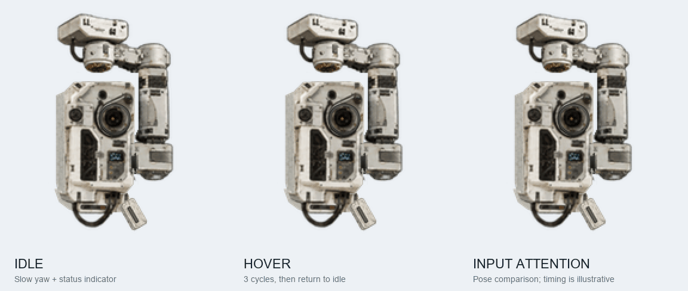
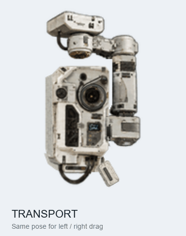
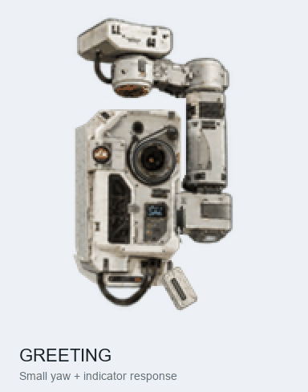
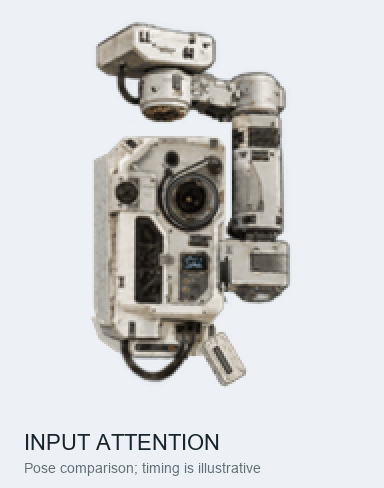
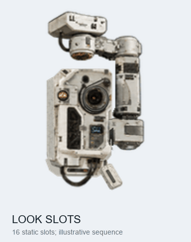
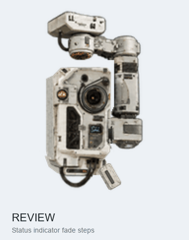
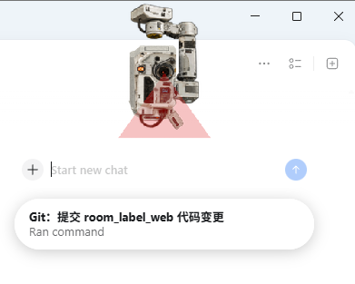

# MOSS Pet

《流浪地球》550W / MOSS 非官方宠物，提供 PNG 成品、Blender 模型和 Codex Skill。



**[下载 PNG](MOSS.png)** · [Blender 模型](assets/model/MOSS.blend) · [Codex Skill](.agents/skills/moss-animation-design/SKILL.md)

## 使用方式

### 1. PNG 导入（推荐）

下载原始 [MOSS.png](MOSS.png)，交给支持自定义宠物的 Codex / ChatGPT Work 导入。无需 Blender、Python 或 Skill。

文件是 **v2 精灵图，1536 × 2288**；只支持 v1 的入口不兼容。不要缩放、截图或裁掉最后两行。名称与简介见 [release.json](release.json)。

### 2. Skill 定制

下载完整仓库，在 Codex 中打开该目录并输入：

```text
$moss-animation-design
把悬停时底部附件的摆动改成左右各 5°，其他动作和外观不变。
先给我预览和 PNG，不更新线上宠物。
```

改动作用于 [动画配置](config/animation.json) 或 [Blender 模型](assets/model/MOSS.blend)。模型已内嵌全部贴图；本地渲染需要 Python、Pillow 和 Blender。

[渲染命令与模型说明](.agents/skills/moss-animation-design/references/design.md#渲染与合成) · [客户端兼容与触发说明](.agents/skills/moss-animation-design/references/runtime.md)

### 分享状态（待验证）

Pets 工具生成的 [MOSS 分享链接](https://chatgpt.com/s/sharepet_6aca8ec905a881919a85c47f128383f6)可显示未登录预览，但已观察到登录后提示“无权访问此对话”并报错。尚未验证成功领养，原因未确定；当前请使用 PNG 导入。

## 效果展示

GIF 从发布 PNG 拆格制作；扫描和方向槽的切换时长仅作展示。

<details>
<summary>查看全部动作与灯效</summary>

| 待机 | 悬停 | 拖动收纳 |
| --- | --- | --- |
|  |  |  |
| 招呼 | 输入关注 | 方向槽 |
|  |  |  |

| 工作 | 等待 | 检查 | 失败 |
| --- | --- | --- | --- |
|  |  |  |  |

</details>

<details>
<summary>真实客户端截图</summary>



使用者客户端中的低头扫描画面。

</details>

## 仓库内容

| 路径 | 用途 |
| --- | --- |
| `MOSS.png` / `release.json` | 成品、版本、校验和与分享链接 |
| `assets/model/` | Blender 模型，含内嵌贴图 |
| `assets/official/` | 21 张官方参考原图与来源清单 |
| `assets/previews/` / `assets/screenshots/` | 11 个 GIF / 1 张真实客户端截图 |
| `config/` / `scripts/` | 动画参数、渲染、合成与校验工具 |
| `.agents/skills/` | Codex Skill 和详细设计说明 |

当前版本为 `2026-10-12-shell-refined`。精确恢复以原 PNG 为准，模型重渲染不保证逐像素相同。上下俯仰的视觉协调仍待改进，7 个方向槽共用低头扫描姿态；触发和播放时序受客户端控制。

## 来源与许可

官方参考来自“电影流浪地球”发布的[机核美术设定“UEG”篇](https://www.gcores.com/articles/162106)，原图链接与署名见 [sources.json](assets/official/sources.json)。

原创脚本、文档和 Skill 采用 [MIT](LICENSE)；角色 PNG、模型、官方美术及展示素材不纳入 MIT，详见 [NOTICE.md](NOTICE.md)。

## 社区链接

[LINUX DO](https://linux.do/) — 真诚、友善、团结、专业的技术社区。
